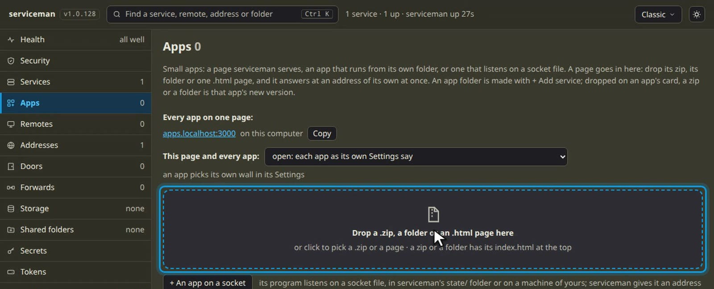
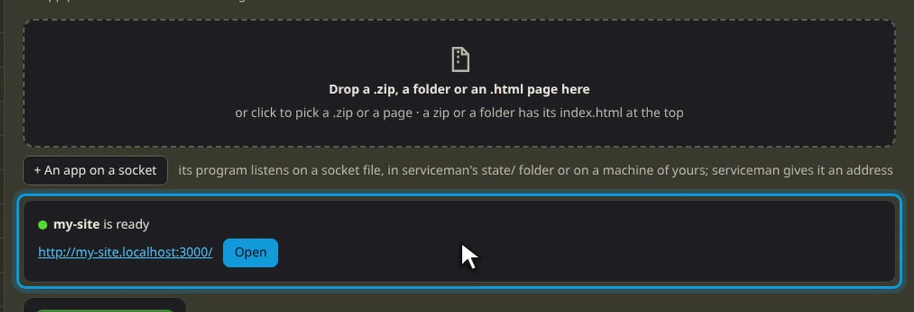
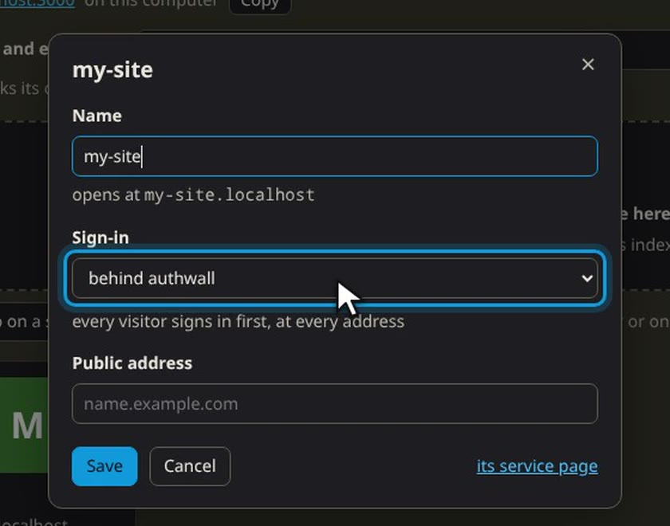
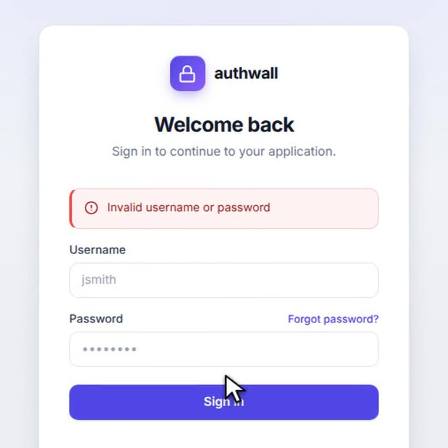

## Article

A small website, a prototype or a page of notes for your team, goes online with serviceman in
a few seconds: a zip of its folder on the **Apps** page, and it answers at an address of its
own. One setting then keeps it for the people you choose: every visitor signs in first, at
every address the site has.

**In this tutorial**

- [Put the site on the Apps page](#give-it-the-site)
- [Open it](#open-it)
- [Put a sign-in in front of it](#sign-in)
- [Visitors sign in first](#visitors-sign-in)

### Put the site on the Apps page {#give-it-the-site}

1. Open **Apps** in the sidebar.
2. Click the card at the top, **Drop a .zip, a folder or an .html page here**, and pick the zip
   of your site. Dropping the zip on the card works the same.
3. The zip has its `index.html` at the top, or in its one folder: that is the page a visitor
   gets first.

### Open it {#open-it}

1. A line under the card says **my-site is ready**, with the site's address, made from the
   zip's name: `my-site.localhost` on this computer.
2. Click **Open**: the site answers at once. Anyone who knows the address can open it now.

### Put a sign-in in front of it {#sign-in}

1. On the site's card, click **Settings**.
2. Under **Sign-in**, choose **behind authwall**. The line under it says "every visitor signs in
   first, at every address".
3. Click **Save**. A lock appears before the site's address on its card, and the sidebar's
   **Authwall** counts one more app.

authwall is already set up here: setting it up is [its own tutorial](00-authwall.md).

### Visitors sign in first {#visitors-sign-in}

1. Open the site's address again: authwall's sign-in page answers it, on the site's own name.
2. A wrong password is refused: "Invalid username or password".
3. With the right one, the site opens, and stays open for the rest of the visit.

## Tutorial scenario

**Goal:** Put a small website online at an address of its own, then keep it for the people you
choose.
**Audience:** Someone who runs serviceman for themselves or a small team and has a static site
to share.
**Prerequisites:** serviceman running; authwall set up as [tutorial 00](00-authwall.md) leaves
it, with a user to sign in as.
**Example:** `my-site.zip`, one `index.html` ("My site / A folder of HTML, served by
serviceman."), put online as `my-site`, behind authwall.

**Steps**
1. Apps → the drop card → pick `my-site.zip`.
2. "my-site is ready" → **Open**: the site.
3. The site's card → **Settings** → Sign-in: **behind authwall** → **Save**.
4. The site's address again: the sign-in page; a wrong password refused; the right one, the site.

**Result:** `my-site.localhost` answers only after authwall has said who the visitor is.

## Video recording scenario

**Length:** ~1.5 min · **Picture:** 1920×1080 (the browser 1280×720 at 1.5×), dark theme ·
**Start state:** a fresh serviceman with authwall as a service (tutorial 00), no app yet; the
user `demo` on authwall

| # | Scene | On screen (action) | Duration |
|---|---|---|---|
| 1 | Intro | Title card: "A website online, with a sign-in" | 8s |
| 2 | Give it the site | Apps; the drop card outlined; the file window, `my-site.zip`, Open | 20s |
| 3 | It's online | "my-site is ready" outlined; Open; the site | 15s |
| 4 | Put a sign-in in front of it | Apps; the card's Settings; Sign-in: behind authwall; Save; the lock outlined | 25s |
| 5 | Visitors sign in first | the card's address; the sign-in page; a wrong password refused; the right one; the site | 25s |
| 6 | Recap | Recap card, five lines | 15s |

## Voiceover script

### Scene 1 — Intro
In this tutorial, I'll show you how to put a small website online with serviceman, and keep it for the people you choose.

All it takes is a zip of the site, and one setting.

### Scene 2 — Give it the site
This is the Apps page. Everything you put here answers at an address of its own.

Let's give it a website: a zip of its folder, with its index page at the top.

I'll pick the zip of my site.

### Scene 3 — It's online
It's online at once, at an address made from its name.

Let's open it.

And there's the site. Right now, anyone who knows this address can open it.

### Scene 4 — Put a sign-in in front of it
Let's keep it for our own people. On the site's card, open Settings.

Under Sign-in, choose behind authwall. Authwall is already set up here; setting it up is a tutorial of its own.

Now let's save.

The lock on the card says that every visitor signs in first.

### Scene 5 — Visitors sign in first
Let's open the site's address again.

This time, the same address asks who you are. A wrong password gets no further.

With the right one, the site opens, and it stays open for the rest of the visit.

### Scene 6 — Recap
That's all it takes: a zip on the Apps page puts a site online, and one setting keeps it for the people you choose.

Whenever a page is for your team and nobody else, put it behind a sign-in.

Thanks for watching, and see you in the next tutorial.

## Audit notes

Every step tried in a fresh serviceman on 2026-11-16, with authwall 1.16.0 as a service: each
step answers in under a second, so the video cuts no wait. The list under the drop card catches
up about a second after "is ready", so the scene holds before its next words. authwall's
sign-in page is light where serviceman's is dark: the cut to it is a cross-fade. The lock on the
card is small: it is outlined while it is named.
